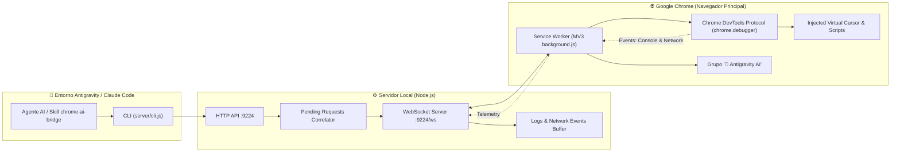

# 🤖 Antigravity AI Chrome Bridge

Puente de alta fidelidad entre **Google Chrome** y **Antigravity AI / Claude Code** para navegación interactiva, pruebas en vivo, emulación responsiva de dispositivos, inspección en tiempo real de consola y red (CDP), automatización de formularios y **simulación multi-usuario aislada (chat / colaboración en tiempo real)** directamente en el navegador principal del usuario sin reiniciarlo.

---

## 🏗️ Arquitectura del Sistema



---

## 🌟 Características Avanzadas

### 1. Control Sin Reinicio de Chrome
Se ejecuta como una extensión Manifest V3 estándar en tu navegador de trabajo. No requiere banderas `--remote-debugging-port`, Selenium, Puppeteer ni ChromeDriver.

### 2. Cursor Virtual Animado (*Glide & Physics Press*)
Para evitar saltos abruptos o clics invisibles, la extensión inyecta un cursor SVG flotante `#9333ea` con física visual realista:
- **Deslizamiento Fluido (*Glide*):** Calcula la distancia euclidiana hacia las coordenadas de destino y anima el cursor con curvas de aceleración `cubic-bezier(0.22, 1, 0.36, 1)`.
- **Presión Física (*Press Down*):** Al alcanzar el elemento, el cursor se reduce a escala `0.82` simulando el clic físico del mouse.
- **Efecto Ripple:** Dispara una onda expansiva translúcida para retroalimentación visual clara.

### 3. Desplazamiento Suave (*Smooth Scroll*)
Si un elemento objetivo se encuentra fuera del área visible (*viewport*), la extensión ejecuta un desplazamiento suave y centrado (`scrollIntoView({ behavior: 'smooth', block: 'center' })`) antes de desplazar el puntero. También soporta scroll relativo arbitrario (`scroll --tab <id> --y <px>`).

### 4. Emulación Responsiva de Dispositivos (Mobile / Tablet / Desktop)
Mediante CDP `Emulation.setDeviceMetricsOverride`, conmuta dinámicamente la resolución y emulación táctil en la pestaña:
- **Mobile:** iPhone 14/15/16 (`390 x 844`, escala `3.0`, soporte táctil activo).
- **Tablet:** iPad (`768 x 1024`, escala `2.0`, soporte táctil activo).
- **Desktop:** (`1440 x 900`, escala `1.0`).
- **Reset:** Restablece las dimensiones naturales de la ventana.

### 5. Agrupación Visual Inteligente (*Tab Groups*)
Todas las pestañas abiertas o adjuntadas por la IA se reúnen de manera limpia bajo el grupo morado unificado **`🤖 Antigravity AI`**. Tu navegador permanece ordenado y no se mezcla con tus pestañas personales.

### 6. Auto-Wait con Polling Resiliente
Los comandos `click` y `type` esperan automáticamente hasta 5.000 ms mediante polling continuo (intervalos de 60 ms) a que los selectores CSS o textos existan en el DOM, resolviendo discrepancias de hidratación en React, Next.js, Vue y Svelte.

### 7. Bypass Completo de CSP mediante CDP
En sitios con Content Security Policy estricta (`unsafe-eval` bloqueado), la extensión redirige la ejecución de scripts a través del dominio `Runtime.evaluate` del Chrome DevTools Protocol, ejecutando código con privilegios elevados de DevTools sin bloqueos.

### 8. Monitoreo de Red y Consola en Tiempo Real
- **Red:** Intercepta respuestas con status `>= 400`, fallos de red (`net::ERR_*`) y errores de CORS (`Network.responseReceived` y `Network.loadingFailed`).
- **Consola:** Intercepta `console.log`, `console.warn`, `console.error` y excepciones de JavaScript no capturadas (`Runtime.exceptionThrown`).

### 9. Soporte Multi-Perfil Simultáneo (Personal / Trabajo)
Permite conectar simultáneamente múltiples perfiles independientes de Chrome (ej. ventana con correo personal 1 y ventana con correo personal 2 o trabajo). Cada perfil puede etiquetarse con un nombre amigable en el popup de la extensión. El servidor multiplexa las conexiones y enruta las acciones automáticamente por el `tabId` de la pestaña o explícitamente mediante el flag `--profile <nombre>`.

### 10. Nombres Contextuales de Tareas e Ideas en Pestañas
Al abrir pestañas mediante `open --task "<propósito>"`, el puente nombra tanto el chip del grupo de pestañas en Chrome (`🤖 <Tarea>`) como el título del documento (`🤖 [<Tarea>] <TítuloOriginal>`). Esto permite al usuario ver en su barra de pestañas exactamente qué tarea o idea está ejecutando la IA en cada momento.

### 11. Pruebas Multi-Usuario y Modo Incógnito
Permite abrir pestañas en modo Incógnito con cookies, almacenamiento local y sesiones de autenticación completamente independientes de la sesión normal del usuario, permitiendo simular interacción de múltiples participantes en tiempo real.

---

## 🚀 Instalación y Puesta en Marcha

### Paso 1: Iniciar el Servidor Daemon
```bash
git clone https://github.com/yogui-dev/chrome-ai-bridge.git
cd chrome-ai-bridge
pnpm install
pnpm start
```
El servidor HTTP y WebSocket escuchará localmente en `http://localhost:9224` y `ws://localhost:9224/ws`.

### Paso 2: Cargar la Extensión en Chrome
1. Abre Google Chrome y navega a `chrome://extensions/`.
2. Habilita el **"Modo de desarrollador"** (Developer mode) en la esquina superior derecha.
3. Haz clic en **"Cargar descomprimida"** (Load unpacked).
4. Selecciona el subdirectorio `extension/` del repositorio:
   ```text
   ./extension
   ```
5. *(Recomendado para pruebas multi-usuario / chats)*: Haz clic en **Detalles** dentro de la tarjeta de la extensión y activa **"Permitir en incógnito"**.

---

## 💻 Referencia Completa de Comandos CLI

El CLI puede invocarse desde la raíz del proyecto mediante `node server/cli.js` o `pnpm cli`:

```bash
# 1. Diagnóstico y estado de la conexión (muestra todos los perfiles conectados)
node server/cli.js status

# 2. Listar solo los perfiles de Chrome conectados
node server/cli.js profiles

# 3. Listar pestañas abiertas (opcionalmente filtrando por perfil)
node server/cli.js tabs [--profile "Personal"]

# 4. Abrir una nueva pestaña asignándole la tarea o idea a realizar
node server/cli.js open --url "https://example.com" --task "Auditoría de interfaz"

# 5. Abrir pestaña en un perfil específico de Chrome (ej. Personal o Trabajo)
node server/cli.js open --url "https://admin.example.com" --task "Revisión panel de control" --profile "Personal"

# 6. Actualizar la tarea o idea de una pestaña activa
node server/cli.js task --tab <TAB_ID> --name "Nueva tarea en ejecución"

# 7. Incorporar una pestaña existente al control de la IA
node server/cli.js attach --tab <TAB_ID>

# 8. Abrir una sesión aislada en Incógnito (Multi-Usuario)
node server/cli.js open --url "http://localhost:3000" --task "Usuario B - Invitado" --incognito

# 9. Emular vista responsiva (Mobile / Tablet / Desktop / Reset)
node server/cli.js viewport --tab <TAB_ID> --preset mobile
node server/cli.js viewport --tab <TAB_ID> --preset tablet
node server/cli.js viewport --tab <TAB_ID> --preset desktop
node server/cli.js viewport --tab <TAB_ID> --reset

# 10. Clic con cursor virtual animado (Glide, Press y Ripple)
node server/cli.js click --tab <TAB_ID> --selector "button.btn-primary"
node server/cli.js click --tab <TAB_ID> --text "Guardar cambios"

# 11. Rellenar inputs de texto (con auto-wait)
node server/cli.js type --tab <TAB_ID> --selector "input[name='email']" --text "user@example.com"

# 12. Subir archivos locales (Modo estático tradicional)
node server/cli.js upload --tab <TAB_ID> --file "./sample-file.pdf" --selector "input[type='file']"

# 13. Subir archivos en SPAs dinámicas (Meta Business Suite, Canva, Drive) suprimiendo la ventana nativa de Windows
node server/cli.js upload --tab <TAB_ID> --file "./foto.png" --button "Add photo/video" [--profile "Personal"]

# 13. Desplazamiento suave (Smooth Scroll)
node server/cli.js scroll --tab <TAB_ID> --y 500
node server/cli.js scroll --tab <TAB_ID> --y -300

# 14. Extraer resumen estructurado del DOM
node server/cli.js dom --tab <TAB_ID>

# 15. Monitorear logs de consola capturados en tiempo real
node server/cli.js logs --tab <TAB_ID>

# 16. Inspeccionar errores de red (HTTP >= 400 y CORS)
node server/cli.js network --tab <TAB_ID>

# 17. Captura de pantalla aislada de la página
node server/cli.js screenshot --tab <TAB_ID>

# 18. Evaluar JavaScript arbitrario (Bypass CSP vía CDP)
node server/cli.js eval --tab <TAB_ID> --code "document.title"

# 19. Cerrar pestaña bajo control
node server/cli.js close --tab <TAB_ID>
```

---

## 🧪 Pruebas Automatizadas

La suite de pruebas unitarias y de integración se ejecuta mediante el test runner nativo de Node.js:

```bash
pnpm test
```

### Cobertura de Tests:
- Resonancia de endpoints HTTP `/health`, `/status`, `/logs` y `/network`.
- Ejecución limpia del CLI y parsing de argumentos.
- Conectividad WebSocket y telemetría de eventos de red bidireccionales.
- Envío y recepción de acciones compuestas (`scroll`, `click`, etc.).

---

## 🛡️ Seguridad y Aislamiento

1. **Privacidad de Pantalla:** Las capturas de pantalla tomadas mediante `Page.captureScreenshot` pertenecen exclusivamente a la superficie del documento renderizado en la pestaña objetivo. La barra de tareas del sistema operativo, el escritorio y otras aplicaciones abiertas nunca son capturadas.
2. **Sin Exposición a Red Externa:** El servidor puente se enlaza estrictamente a `127.0.0.1` (`localhost`), impidiendo acceso desde la red local o internet.
3. **Control Voluntario:** El usuario conserva el control absoluto de su navegador: las pestañas pueden cerrarse en cualquier momento y el debugger de CDP puede desmontarse con un clic.

---

## 🤝 Soporte, Feedback y Mejoras

¿Tienes dudas, encontraste un fallo o te gustaría proponer una nueva característica?
* 💡 **Proponer una mejora:** Abre un [Feature Request](https://github.com/yogui-dev/chrome-ai-bridge/issues/new?template=feature_request.md).
* 🐛 **Reportar un problema:** Abre un [Bug Report](https://github.com/yogui-dev/chrome-ai-bridge/issues/new?template=bug_report.md).
* 💬 **Preguntas o debate:** Inicia una conversación en [GitHub Discussions](https://github.com/yogui-dev/chrome-ai-bridge/discussions).

---

## 👤 Autor & Contacto Profesional

Desarrollado y mantenido por **Jorge Arias (`yogui-dev`)**:

* 💼 **LinkedIn:** [linkedin.com/in/jorge-m-arias](https://www.linkedin.com/in/jorge-m-arias/)
* 🐙 **GitHub:** [@yogui-dev](https://github.com/yogui-dev)

---

## 📄 Licencia

Este proyecto se distribuye bajo la licencia **MIT**. Consulta el archivo [LICENSE](./LICENSE) para más detalles.
